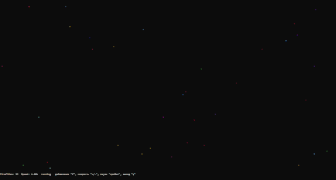

# Лабораторная работа по дисциплине "Компьютерная графика" № 0

[](https://github.com/VadimFitsura/ASCII-graphics.git)
[](https://opensource.org/licenses/MIT)

Программа реализует анимацию ASCII-графики в консоли. По экрану блуждают светлячки `*`, которые двигаются в случайном направлении, периодически замирают, меняют яркость/цвет и отражаются от границ терминала.

## Демонстрация выполнения работы программы 


## Описание задачи
Необходимо разработать консольную программу, которая реализует анимацию движущихся объектов с использованием исключительно стандартного ввода-вывода и управляющих конструкций языка. Программа должна поддерживать интерактивное управление и корректно восстанавливать состояние терминала при завершении. Использование сторонних библиотек запрещено.

## Программа реализована на языке:

| Язык | Интерпретатор/Версия | Среда разработки | 
| ------ | ------ | ------ |
| Python | Python / 3.14.10 | VS Code |

## Используемые библиотеки:
Задействованы только стандартные библиотеки Python:
* `os`, `sys` - для работы с системными вызовами и стандартным потоком вывода
* `time` - для управления задержками (FPS) и игровым циклом
* `random` - для генерации случайных направлений, пауз и смены цветов
* `shutil` - для определения текущего размера окна терминала
* `msvcrt` - для реализации неблокирующего чтения нажатий клавиш

## Описание возможностей:
Программа позволяет визуализировать движение светлячков в терминале. Каждый светлячок движется независимо, отражается от границ экрана, может замирать на месте и менять цвет. Поддерживается интерактивное управление в реальном времени.

## Установка и запуск:
1. Клонируйте репозиторий:
```sh
git clone https://github.com/VadimFitsura/ASCII-graphics.git
```
2. Откройте терминал в папке проекта и выполните следующую команду:
```sh
python ASCII.py
```
## Использование программы:

* Запустите программу из терминала и дождитесь появления анимации
* На экране отобразится движение символов `*`, которые отражаются от границ окна
* Используйте клавиатуру для управления: `Пробел` — пауза, `+` / `-` — изменение скорости, `f` — добавить светлячка, `q` — выход
* Наблюдайте за тем, как светлячки замирают на месте и случайным образом меняют свою яркость